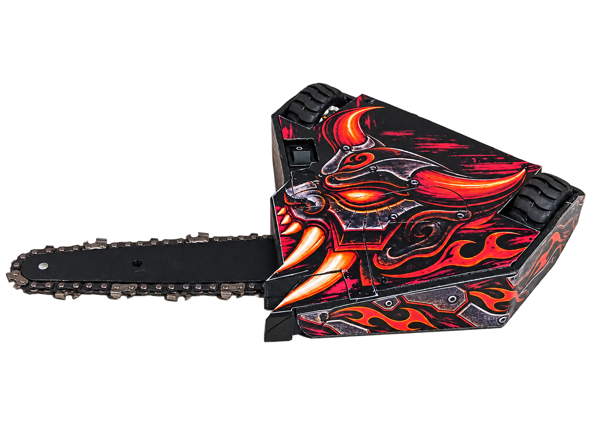
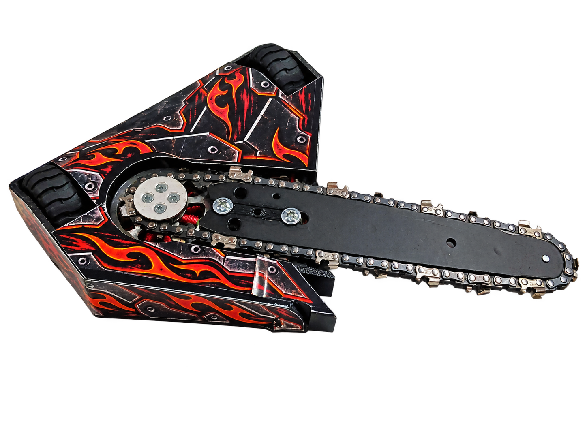
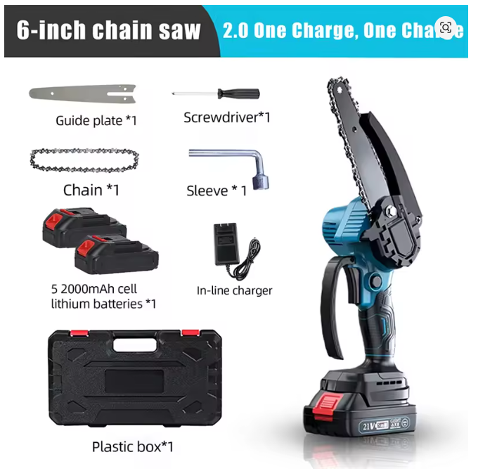
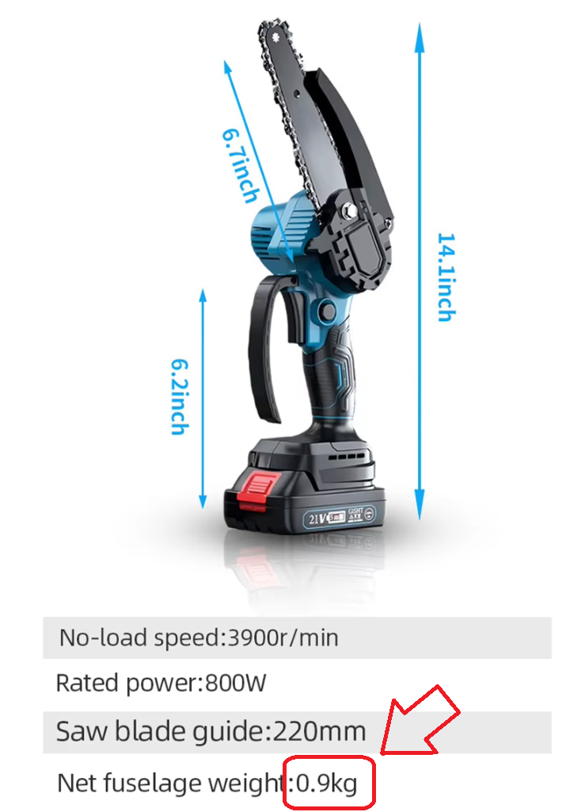
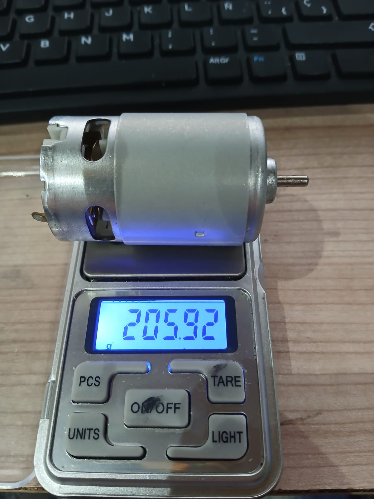
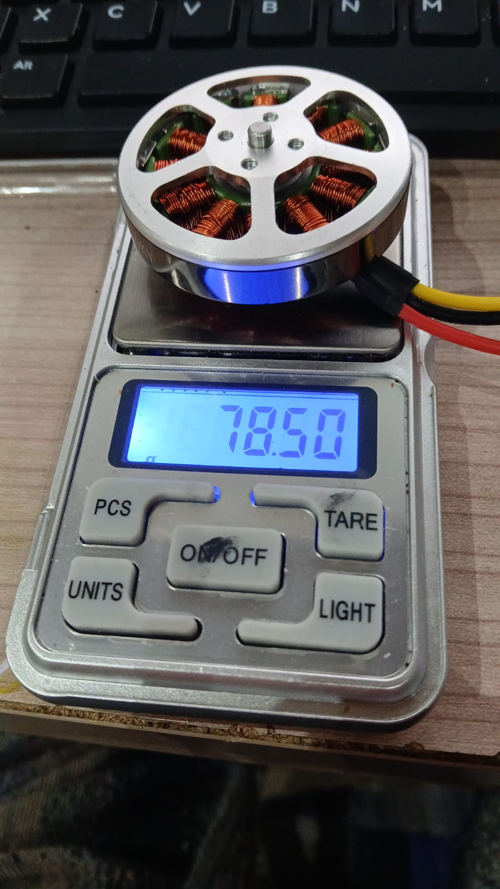
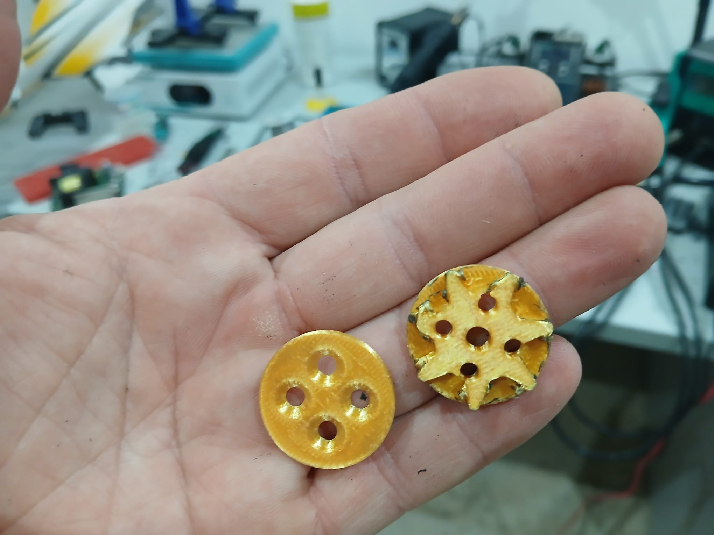
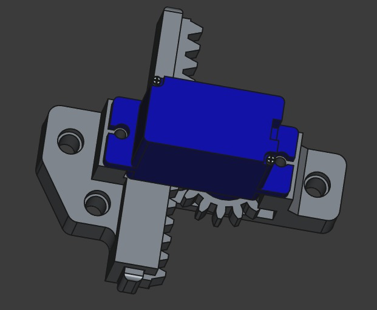
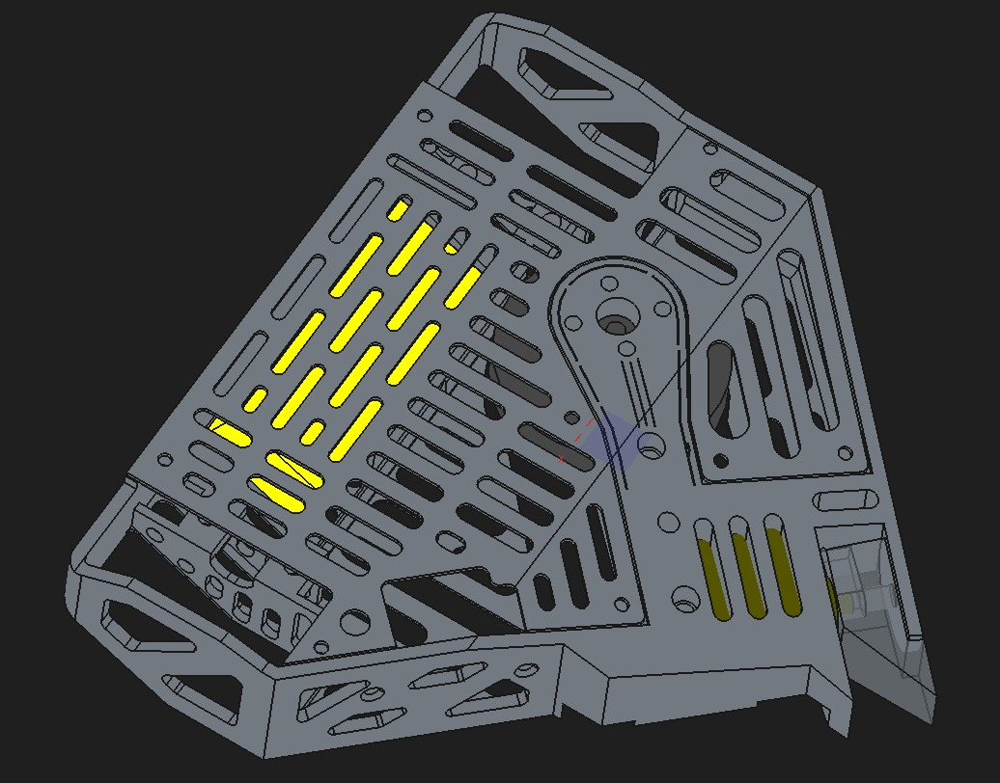
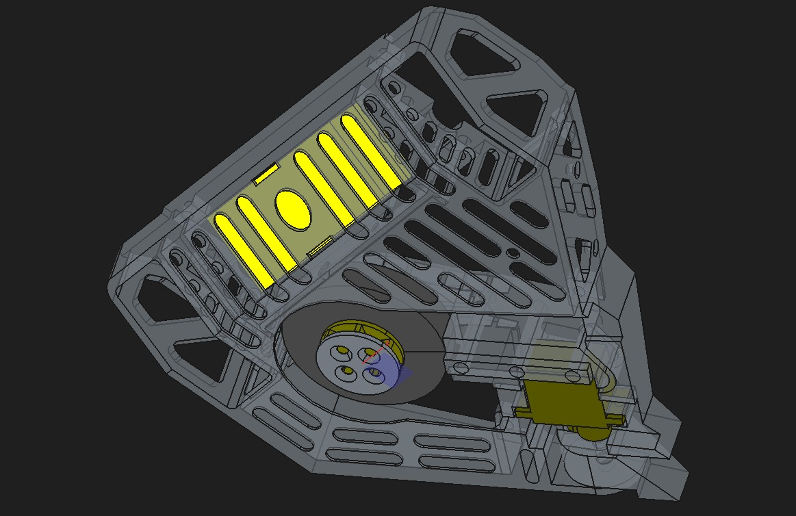

# LIPO INFERNO

Un robot de combate con motosierra. Un proyecto nacido de una conversación entre amigos, unas cuantas pruebas y muchas ganas de inventar.

## Cómo empezó todo

Todo empezó a la vuelta de Robolid 2026. Mi amigo Froilan me comentó que quería participar en la categoría de combate de Oshwdem con un robot de tipo defensivo.

Los robots de combate nunca habían sido una categoría que me llamara especialmente la atención, aunque reconozco que resulta espectacular para el público y muy divertida para quienes participan.

Lo que sí me gusta de estas competiciones es el ambiente. En las competiciones en las que he participado aquí en España, los premios son simbólicos y hay muy buen rollo entre participantes. Al final, estos encuentros son un punto de reunión para gente que comparte la misma afición. Es un mundo pequeño y casi nos conocemos todos.

Cuando diseñas un robot, intentas encontrar una solución a un problema dentro de unas limitaciones. En combate hay que equilibrar el mecanismo de ataque, la resistencia del conjunto y, sobre todo, el peso. También hay robots que apuestan por empujar. Personalmente me resultan menos entretenidos, aunque es una estrategia perfectamente legítima y puede dar muy buenos resultados. A mí, en cambio, me apetecía probar algo distinto.

## Una motosierra como punto de partida

Nada más llegar a casa, busqué cuánto costaban las pequeñas motosierras de mano que se utilizan en jardinería. Me sorprendió lo baratas que eran: compré una en AliExpress por **21 €**, con batería, cargador y envío desde España.

Podría haberla comprado sin batería ni cargador, pero el ahorro era pequeño. La batería ya encontrará su sitio en algún otro invento. El cargador es una castaña.

El gran reto era adaptar aquel conjunto a un robot cuyo objetivo de peso era **una libra, aproximadamente 454 g**.

## Las primeras pruebas

El motor original pesaba demasiado para este proyecto. Necesitaba encontrar una alternativa que encajara en el presupuesto de peso y en el espacio disponible. También quería que el conjunto fuera bajo, por estabilidad y porque desde el principio me interesaba que el robot pudiera seguir funcionando si quedaba boca abajo.

Tuve suerte: el primer motor alternativo que probé dio un resultado que me permitió continuar. No suele pasar a la primera. La diferencia de peso entre ambos montajes era considerable.

Antes de diseñar el robot completo, preparé un montaje provisional para comprobar el concepto. Fue una prueba improvisada, de la que también saqué lecciones sobre cómo plantear los ensayos. La incluyo como parte del desarrollo, no como procedimiento para reproducirla.

[Ver vídeo de la prueba inicial del motor](media/videos/Test%20motor.mp4)

Durante esa prueba, el piñón de la cadena impreso en PLA se fundió y la cadena quedó bloqueada. La pieza sirvió para comprobar las dimensiones, pero no soportó las condiciones de funcionamiento. Después encargué una versión metálica.

*Piezas del montaje de prueba. El fallo del prototipo impreso marcó una de las primeras revisiones del proyecto.*

## Una pata que no levantaba lo que tocaba

Una vez decidida la distribución general, empecé a diseñar el robot. Quería poder variar la altura de la parte delantera y evitar que la motosierra quedara apoyada directamente en el suelo si el robot terminaba boca abajo. Para ello planteé una pata accionada por un servo.

*Primera versión del mecanismo, representada en CAD.*

El mecanismo me gustó mucho y funcionaba bien por separado. Es una de esas ideas que quizá recupere en otro proyecto.

[Ver la prueba del mecanismo de la pata](media/videos/test_pota.mp4)

El problema apareció al integrarlo: no había calculado bien la posición del centro de gravedad. En lugar de levantar la parte delantera, **levantaba una rueda**.

[Ver el problema al probar la pata en el robot](media/videos/test_pota_2.mp4)

Por cierto, el primer prototipo era dorado porque mi hijo había querido que le imprimiera la copa del Mundial. Algo tenía que hacer con el filamento que sobró. :D

Tuve que cambiar la ubicación del servo al otro lado del conjunto y revisar la distribución.

[Ver la prueba con la nueva disposición](media/videos/test_pota_3.mp4)

## La pelea con la báscula

Al principio quería utilizar dos baterías independientes: una para la tracción y la electrónica de control, y otra para la motosierra. Así, si esta última se agotaba, el robot todavía podría moverse. Tuve que descartar la idea porque el peso iba demasiado justo.

Fui reduciendo la masa del chasis hasta quedarme con muy poco margen. Incluso había diseñado pegatinas para todas las caras y, al final, solo pude colocar la superior. Cuando llevé el robot a Oshwdem, me sobraba menos de un gramo respecto al límite con el que estaba trabajando.

*Vista del chasis durante el trabajo de reducción de peso.*

*Otra vista del diseño y de la distribución interior.*

## Lo que pasó en competición

En el primer combate se rompió uno de los puntos críticos del robot: el soporte de la motosierra. A partir de ahí, la cadena se salía.

Es posible que el soporte ya llegara tocado de las pruebas previas, pero no puedo asegurarlo. Habíamos estado practicando los controles con los niños, porque la idea era que ellos lo pilotaran en competición, como así fué.

La sensación inicial fue buena, aunque la alegría duró poco. Me quedé con una conclusión clara: la siguiente revisión necesita mejorar el reparto del peso y la resistencia de los soportes, tomando como referencia lo que realmente falló.

## Lo mío son los inventos

En robótica, tanto en esta categoría como en cualquier otra, lo que más me atrae es probar ideas propias. Entiendo el valor de las soluciones que ya han demostrado funcionar, pero lo que a mí me engancha es imaginar algo, construirlo y descubrir qué pasa.

A veces funciona a la primera. Otras veces levantas la rueda que no tocaba.

## Archivos del proyecto

Mi intención es compartir el código y los archivos de diseño para que otras personas puedan estudiar el proyecto, modificarlo y desarrollar sus propias versiones.

- [Código Arduino](codigo/LipoInferno): programa de control y sus módulos.
- [Diseños FreeCAD](cad/freecad) y [modelos STEP](cad/step).
- [Piezas STL](impresion_3d/stl).
- [Adhesivos en PDF](adhesivos/pdf).
- [Imágenes](media/imagenes) y [vídeos](media/videos).

Los archivos incluyen variantes y pruebas de desarrollo; todavía hay que identificar las piezas que corresponden al montaje definitivo.

<!-- PENDIENTE ANTES DE PUBLICAR: revisar las versiones que se compartirán y elegir una licencia. -->

¡Salud y suerte con vuestros proyectos!
